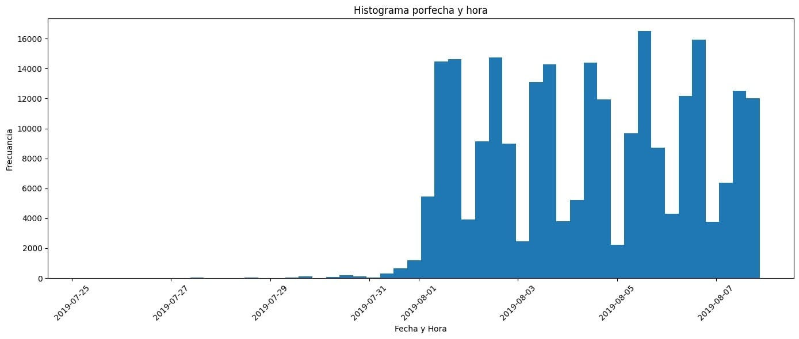

# 🍔 Análisis de Embudo y Test A/A/B - App de Comida

[Python](https://img.shields.io/badge/Python-3776AB?style=for-the-badge&logo=python&logoColor=white)
[Funnel Analysis](https://img.shields.io/badge/Funnel_Analysis-FF6B35?style=for-the-badge)
[A/A/B Test](https://img.shields.io/badge/A%2FA%2FB_Test-4ECDC4?style=for-the-badge)
[Data Cleaning](https://img.shields.io/badge/Data_Cleaning-9B59B6?style=for-the-badge)

> Investigación del comportamiento de usuarios en app de alimentos: desde el embudo de ventas hasta la validación de un nuevo diseño de fuentes con un experimento A/A/B.

## 📁 Archivo: embudo_test_ab_app_comida.ipynb

### 🎯 Objetivo de Negocio
1.  Entender el embudo: ¿Dónde se atascan los usuarios antes de pagar?
2.  Validar un rediseño: ¿Las nuevas fuentes asustan a los usuarios? Decisión basada en datos con test A/A/B (246 y 247 = control fuentes viejas, 248 = prueba fuentes nuevas).

### 🛠️ Stack
Python, Pandas, Matplotlib / Plotly, SciPy.stats, Seaborn, Numpy, Date time

### ✅ Conclusión de Negocio
Antes de la corrección: Pensabas que no había diferencias significativas
Después de la corrección: Confirmas que definitivamente no hay diferencias significativas
Conclusión final:
Con un α ajustado de 0.05/20 = 0.0025, ninguna de tus pruebas alcanza este nivel de significancia más estricto.

---
*Proyecto por [cesarrmixer-beep](https://github.com/cesarrmixer-beep) - Jr. Data Analyst*
